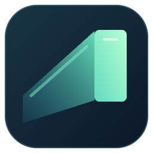

# Lune Glide



**流光 · 让光标如流光般滑行。** Neovide-inspired spring cursor animation.

[源码](https://github.com/BowlofThinSoup/Lune-Glide) · [问题反馈](https://github.com/BowlofThinSoup/Lune-Glide/issues) · [IDEA 安装说明](jetbrains-neovide-cursor/README.md)

原名 Neovide Cursor。0.1.3 统一品牌名称和图标，内部扩展 ID、命令 ID 与 `neovideCursor.*` 配置键保留，可覆盖升级并沿用已有设置。

另有原生 **IntelliJ IDEA 2026.2.x** 插件：源码目录中的 `jetbrains-neovide-cursor/README.md` 提供安装与开发说明，安装包为 `jetbrains-neovide-cursor/build/distributions/lune-glide-jetbrains-0.1.3.zip`。

在 VS Code 原生代码编辑器中复现 Neovide 的四角弹簧光标：前缘先到、后缘跟随，长距离拉伸拖尾，短距离快速收敛。

这是独立的实验性桌面扩展，使用 **工作台脚本注入**，不是官方光标渲染 API。动画核心移植自 MIT 许可的 Neovide；不需要安装 Neovide 或 REA。

## 安装与启用

1. 在 VS Code 的扩展视图菜单中选择 **Install from VSIX…**，安装 `lune-glide-vscode-0.1.3.vsix`。
2. 命令面板运行 **Lune Glide: Enable**。
3. 阅读安装说明并确认，然后选择 **Reload Window**。已有的其他 VS Code 窗口也需要重载。
4. 推荐在 User Settings 中设置 `"editor.cursorStyle": "block"`，四角拖尾会更明显。默认线条光标也支持；插件不自动改动你的编辑器设置。

启用会在 VS Code `resources/app/out/vs/code/.../workbench` 下写入一个外部 JS 文件和带标记的 script 引用，影响这一安装下的所有窗口和配置文件。保留内容哈希命名的原始 HTML 备份。**不会放宽 CSP、修改 product.json 校验值或自动提权。**

VS Code 可能提示安装内容已修改，这是该注入方案的固有限制。应用升级后运行 **Repair After VS Code Update**。Windows/Linux/macOS 受保护的安装目录可能不可写；插件会明确报错，不会自动请求管理员权限。使用你有写权限的 VS Code 安装；不建议对整个编辑器目录放宽权限。

## 动效与设置

```json
{
  "editor.cursorStyle": "block",
  "neovideCursor.animationLength": 0.15,
  "neovideCursor.shortAnimationLength": 0.04,
  "neovideCursor.trailSize": 1,
  "neovideCursor.animateTyping": true,
  "neovideCursor.respectReducedMotion": true,
  "neovideCursor.vfx": "none"
}
```

- `animationLength`：弹簧时间参数，单位秒，默认 0.15。
- `shortAnimationLength`：同一行两字符以内的快速运动，默认 0.04。
- `trailSize`：0–1，1 最接近 Neovide 默认的前后缘差速，0 为四角同步。
- `animateTyping`：是否对短移动执行动画。
- `respectReducedMotion`：跟随系统“减少动态效果”；开启时系统减少动态效果会让插件回退原生光标。
- `vfx`：`none` 或实验性的 `railgun` 粒子拖尾；不是 Neovide 全套粒子效果的逐项移植。
- `particleLifetime` / `particleCount`：粒子寿命和每个编辑器的数量上限。

设置使用 **User 层级**，不接受项目提供的参数。修改后运行 **Apply Settings** 并重载窗口。动画只在移动时接管光标，停止后由原生光标负责文字、闪烁和精确落点。

支持多个光标、分屏实例、实际像素定位、视口裁剪、滚动偏移修正、DOM 和 EditContext 的输入法组合事件，以及失焦恢复。不拦截键盘、鼠标、文本输入，不联网。

## 禁用和恢复

**卸载扩展前先执行 Lune Glide: Disable (Restore Native Cursor)，然后重载所有窗口。** VS Code 没有可靠的扩展卸载回调，仅卸载或禁用扩展本身不会撤销已经写入的工作台脚本。

如果插件命令不可用，在项目目录执行（需要 Node.js 20+）：

```sh
node scripts/recover.mjs status "/Applications/Visual Studio Code.app/Contents/Resources/app"
node scripts/recover.mjs disable "/Applications/Visual Studio Code.app/Contents/Resources/app"
```

Windows 通常为 `<VS Code 安装目录>/resources/app`，Linux 通常为 `/usr/share/code/resources/app`。恢复工具和构建后的 `dist/installer.cjs` 也包含在 VSIX 中。

恢复只移除完整匹配的 `neovide-cursor:start` / `neovide-cursor:end` 区块，不会用旧备份覆盖升级后的文件，也不会移除其他扩展的修改。若标记被修改，工具拒绝猜测性覆盖：退出 VS Code 后检查该区块，或重装官方 VS Code 应用程序。用户配置和工作区不在修改范围内。

## 开发

Node.js **22.18+**（测试直接运行 TypeScript）。

```sh
npm ci
npm run typecheck
npm test
npm run build
npx playwright install chromium
npm run test:browser
npm run package
```

首次获取源码：

```sh
git clone https://github.com/BowlofThinSoup/Lune-Glide.git
cd Lune-Glide
```

VS Code 插件位于仓库根目录，IDEA 插件位于 `jetbrains-neovide-cursor/`。安装包由上述构建命令生成，不纳入源码版本控制；目前尚未发布插件市场。

也可指定本机 Chrome 执行浏览器测试：

```sh
CHROMIUM_PATH="/Applications/Google Chrome.app/Contents/MacOS/Google Chrome" npm run test:browser
```

`src/motion.ts` 是独立动画核心，`src/renderer.ts` 是 Monaco DOM/Canvas 适配，`src/installer.ts` 是可恢复安装器，`src/extension.ts` 提供命令与设置。生产包没有第三方运行时依赖。

## 已知边界

- 桌面 VS Code，当前检查基线 1.143.0；其他版本和 Windows/Linux 尚未完成实机矩阵验证。
- 使用非公开 Monaco DOM，更新可能失效。Show Status 检查安装文件，不代表当前窗口已重载或运行时已握手。
- Web、终端、Notebook 不在首版支持范围。
- 方块光标移动中优先绘制 Monaco 提供的字符；没有可用字符时使用半透明形状保证可读，静止后恢复原生绘制。复杂字体、连字和真实输入法需要持续实机验证。
- 粒子仅为可选近似效果。核心四角弹簧和 Neovide 默认参数已移植，但不承诺所有状态像素级一致。

测试证据见 `docs/verification.md`。上游来源与许可见 `THIRD_PARTY_NOTICES.md`。

## 图标与性能基准

两个插件共用原创四角拖尾光标图标，源文件为 `assets/icon.svg`。运行 `npm run build:icons` 生成 VS Code PNG 和 JetBrains 明暗主题 SVG。

运行 `npm run build && npm run benchmark` 复现浏览器渲染基准；可用 `CHROMIUM_PATH` 指定 Chrome。数据、方法和限制见源码目录中的 `docs/performance/README.md`。浏览器数据不等于完整 VS Code 进程占用；IDEA 离屏绘图数据也不等于完整 IDEA 窗口占用。
